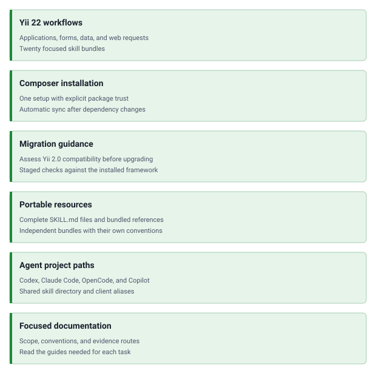

<!-- markdownlint-disable MD041 -->
<p align="center">
    <picture>
        <source media="(prefers-color-scheme: dark)" srcset="https://www.yiiframework.com/image/design/logo/yii3_full_for_dark.svg">
        <source media="(prefers-color-scheme: light)" srcset="https://www.yiiframework.com/image/design/logo/yii3_full_for_light.svg">
        
    </picture>
    <h1 align="center">Skills</h1>
    <br>
</p>
<!-- markdownlint-enable MD041 -->

<p align="center">
    <a href="https://github.com/yii2-extensions/skill/actions/workflows/quality.yml" target="_blank">
        
    </a>
</p>

<p align="center">
    <strong>Agent skills for Yii 22 applications</strong><br>
    <em>Application workflows, framework subsystems, and Yii 2.0 upgrades</em>
</p>

Portable instructions and referenced resources for coding agents working with Yii applications.
The package provides twenty focused workflows independently of the framework runtime.

## Features

<picture>
    <source media="(min-width: 768px)" srcset="./docs/svgs/features.svg">
    
</picture>

## Quick start

### Installation

Create the application's `skills.json` using the [installation guide](docs/installation.md), then install the bundle:

```bash
composer config repositories.yii2-skill vcs https://github.com/yii2-extensions/skill
composer config allow-plugins.llm/skills true
composer require --dev llm/skills:1.15.0 yii2-extensions/skill:dev-main
```

The Composer installer requires PHP 8.2+ and explicit trust for this package.
Later dependency installs and updates synchronize its skills automatically.

### Basic usage

List the installed workflows and choose the one matching the task:

```bash
composer skills:show
```

For example, request `$yii2-forms-validation` in Codex for an ActiveForm task, or use `yii2-upgrade-22` to assess
an existing Yii 2.0 application's migration. See the [skill catalog](skills/README.md) and
[client examples](docs/examples.md).

## Documentation

- 📚 [Installation Guide](docs/installation.md): one-time Composer setup and optional installers.
- ⚙️ [Configuration Guide](docs/configuration.md): trust, synchronization, aliases, and cleanup.
- 💡 [Usage Examples](docs/examples.md): select and invoke the appropriate workflow.
- 🤖 [Skill Catalog](skills/README.md): all twenty framework skill bundles.

## AI assistance

Read the chosen skill's complete `SKILL.md` and its referenced resources. Match the installed framework revision
before applying Yii 22 guidance; each bundle includes its scope, relevant documentation, and observable checks.

For matching hosted documentation, use <https://yii2-framework.github.io/docs/llms.txt> to select focused pages.
When hosted material does not match the installed code, use the available source and PHPDoc.

## Package information

[](https://github.com/yiisoft/yii2/tree/22.0)

The workflows target Yii 22. The bundle contains instructions and resources and has no runtime dependencies.

## Project status

[](https://github.com/yii2-extensions/skill/actions/workflows/quality.yml)

## Our social networks

[](https://x.com/Terabytesoftw)

## License

[](LICENSE)

See [source attribution](NOTICE.md) for the imported framework workflows.
